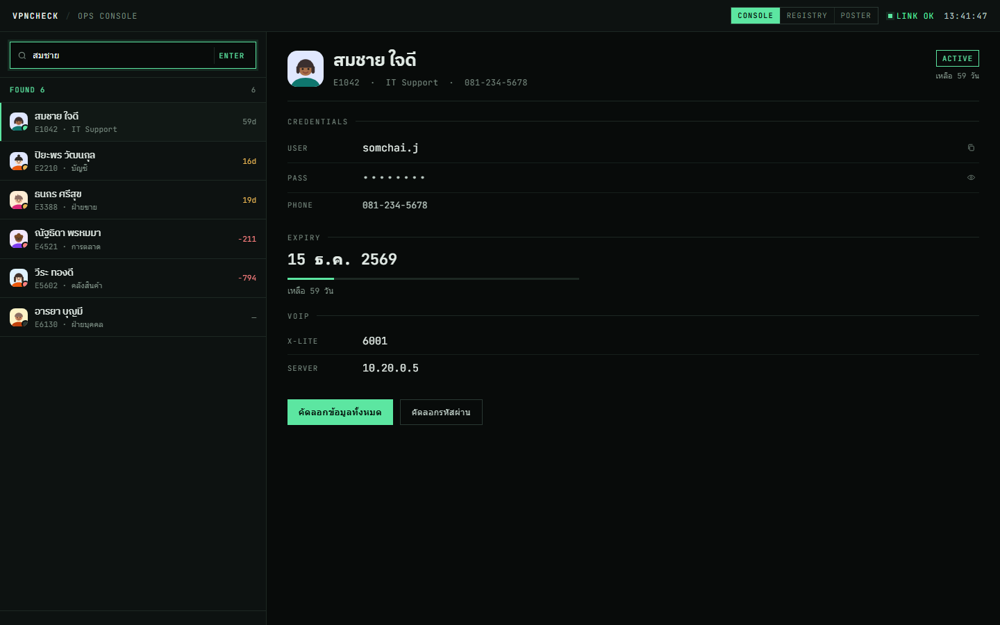

# VPNcheck Co-worker — ทะเบียนบัญชี VPN

เว็บแอปหน้าเดียวสำหรับค้นหาข้อมูลบัญชี VPN ของทีม (บัญชีผู้ใช้ / รหัสผ่าน / วันหมดอายุ / เบอร์ติดต่อ / VoIP)
ดึงข้อมูลจาก **Google Apps Script Web App** และแสดงผลได้ 3 รูปแบบ (template) ที่สลับกันได้จากในหน้า



> ภาพตัวอย่างใช้ข้อมูลสมมติ ไม่ใช่ข้อมูลพนักงานจริง

## โครงสร้างไฟล์

```
.
├── index.html                 # หน้าแรก — เทมเพลต Console (ค่าเริ่มต้น)
├── template-registry.html     # เทมเพลต ทะเบียน (ตารางกระดาษ)
├── template-poster.html       # เทมเพลต โปสเตอร์ (ขอบหนา)
├── assets/
│   └── avatar.js              # ตัวสร้าง avatar การ์ตูน (SVG ในเครื่อง)
├── preview.png                # ภาพประกอบ README
└── README.md
```

## เริ่มใช้งาน

1. เปิดไฟล์ `index.html` ในเบราว์เซอร์ได้เลย (ดับเบิลคลิก / เปิดผ่าน static host)
2. แก้ URL ของ Apps Script ในไฟล์ที่ต้องการ — ค้นหา `var SCRIPT_URL` (มีไฟล์ละ 1 จุด)

```js
var SCRIPT_URL = 'https://script.google.com/macros/s/XXXX/exec';
```

3. ฝั่ง Apps Script ต้องรับพารามิเตอร์ `action=search&keyword=...` และตอบกลับเป็น JSON:

```json
{
  "results": [
    {
      "id": "E1042",
      "name": "สมชาย",
      "surname": "ใจดี",
      "dept": "IT Support",
      "phone": "081-234-5678",
      "user": "somchai.j",
      "pass": "Vpn@2026",
      "expire": "15/12/2569",
      "xlite": "6001",
      "server": "10.20.0.5"
    }
  ]
}
```

รองรับชื่อฟิลด์สำรองด้วย: `empId`, `firstName`/`lastName`, `department`, `tel`, `username`, `password`, `expiry`, `svr`
และรองรับวันหมดอายุหลายรูปแบบ (ค.ศ./พ.ศ., `dd/mm/yyyy`, `yyyy-mm-dd`)

## เทมเพลต

สลับได้จากปุ่มบนหัวหน้าเว็บทุกหน้า (ตำแหน่งต่างกันตามดีไซน์) — คำค้นจะถูกส่งต่อไปยังเทมเพลตปลายทางให้อัตโนมัติ

| เทมเพลต | ไฟล์ | ลักษณะ |
|---|---|---|
| Console | `index.html` | แยก 2 ฝั่ง รายการ + รายละเอียด โทนมืด |
| Registry | `template-registry.html` | ตารางเส้นบาง สไตล์ทะเบียนกระดาษ |
| Poster | `template-poster.html` | ขอบดำหนา เงาแข็ง สไตล์โปสเตอร์ |

### เพิ่มเทมเพลตใหม่
1. คัดลอกไฟล์เทมเพลตที่ใกล้เคียงที่สุด แล้วแก้หน้าตา/เลย์เอาต์
2. เพิ่มลิงก์ในบล็อก `.tpl` ของทุกไฟล์ (และใส่ `class="on"` ให้ไฟล์ตัวเอง)
3. ถ้าฟิลด์ข้อมูลเปลี่ยน ให้แก้ที่ฟังก์ชัน `pick(info, [...], '—')` ในไฟล์นั้น

## ฟีเจอร์

- ค้นหาด้วยรหัสพนักงานหรือชื่อ-นามสกุล (กด Enter)
- คัดลอกทีละค่าได้ทุกช่อง หรือคัดลอกทั้งรายการในคลิกเดียว
- ซ่อน/แสดงรหัสผ่าน (ค่าเริ่มต้นซ่อนไว้)
- แสดงสถานะวันหมดอายุ: ใช้งานได้ / ใกล้หมดอายุ (≤30 วัน) / หมดอายุแล้ว
- โหลดผลลัพธ์ทีละ 10 รายการ
- avatar การ์ตูนสร้างจากรหัสพนักงาน — **ไม่มีการเรียกบริการภายนอก** และไม่ส่งข้อมูลออกนอกองค์กร
- ไม่มี dependency / ไม่มี build step — เป็น HTML ธรรมดา

## ความปลอดภัย

- หน้านี้แสดง **รหัสผ่านจริง** จากฐานข้อมูล — ควรจำกัดการเข้าถึง (เช่น หลัง VPN หรือ SSO) และไม่ควรเปิดเป็น public repo
- มีช่องกรอกรหัสก่อนใช้งาน (รหัสคือ **เบอร์ Helpdesk ภายใน**) จำสถานะไว้ใน `sessionStorage` ต่อแท็บ
- ⚠️ ช่องรหัสนี้เป็นเพียงการกันคนที่เปิดเจอโดยบังเอิญ — โค้ดและ URL ของ API ยังอ่านได้จากเบราว์เซอร์ ถ้าต้องการความปลอดภัยจริงต้องจำกัดที่ตัว API/โฮสต์ (เช่น Google Apps Script แบบต้องล็อกอิน, VPN, Cloudflare Access)
- ถ้าจะขึ้น GitHub แนะนำให้เป็น **private repository**
- ค่าที่ได้จาก API ถูก escape ก่อนแสดงผลทุกจุด เพื่อกัน HTML injection

## เครดิต

สนับสนุนงานโดย Antonial 7769
